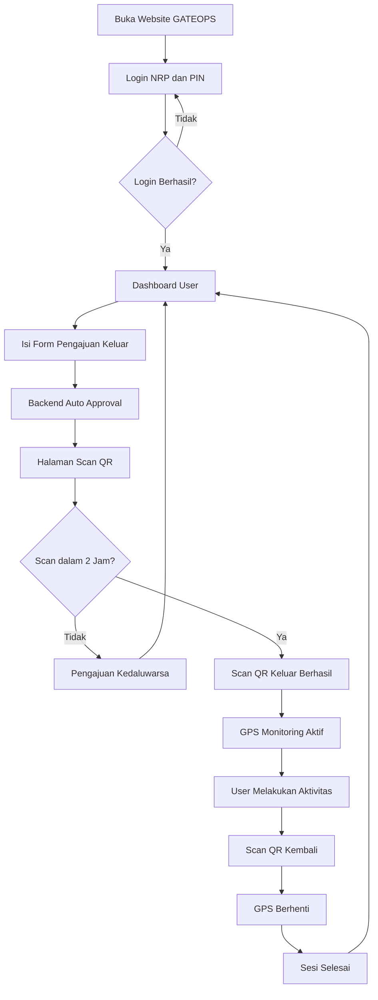
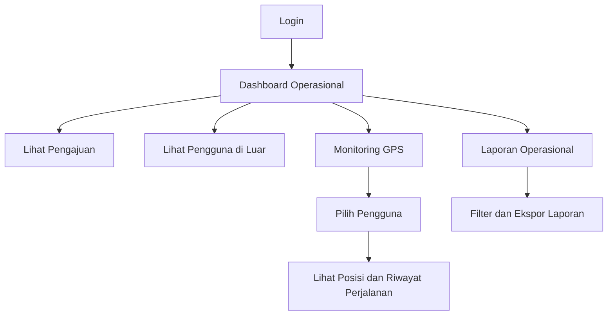

### SPESIFIKASI FRONTEND GATEOPS

GATE Operations & Personnel Monitoring System

Dokumen spesifikasi teknis — Antarmuka Website, Navigasi, Halaman, dan Interaksi Pengguna

### 1\. Gambaran Umum

Frontend GATEOPS merupakan bagian aplikasi website yang berfungsi sebagai antarmuka antara pengguna dengan sistem backend. Frontend menyediakan tampilan untuk login, dashboard, pengelolaan data, pengajuan keluar, pemindaian QR Code, pemantauan GPS, dan laporan operasional.

Frontend dibangun menggunakan Next.js dengan desain responsif agar dapat diakses melalui browser desktop, laptop, tablet, maupun smartphone.

Frontend tidak menyimpan atau menentukan keputusan transaksi penting secara mandiri. Seluruh validasi hak akses, status pengajuan, batas waktu, transaksi QR, dan penyimpanan GPS tetap diproses oleh backend.

### 1.1 Tujuan frontend

* Menyediakan antarmuka yang mudah digunakan oleh seluruh pengguna.

* Menampilkan informasi sesuai hak akses setiap role.

* Memudahkan proses pengajuan keluar dan scan QR.

* Menampilkan status aktivitas dan lokasi GPS secara informatif.

* Memudahkan Admin Operasional memantau personel yang berada di luar.

* Menyediakan tampilan laporan yang mudah dibaca dan dicetak.

### 1.2 Teknologi frontend

| Komponen           | Teknologi                                    | Fungsi                                                         |
| ------------------ | -------------------------------------------- | -------------------------------------------------------------- |
| Framework          | Next.js                                      | Membangun aplikasi website.                                    |
| Bahasa pemrograman | TypeScript                                   | Pengembangan kode frontend yang terstruktur.                   |
| UI                 | Tailwind CSS                                 | Pengaturan tampilan dan responsivitas.                         |
| Komponen UI        | Reusable UI Components                       | Menyeragamkan tombol, tabel, form, modal, dan elemen tampilan. |
| Data fetching      | Fetch API                                    | Mengambil dan mengirim data ke backend.                        |
| Form validation    | Zod atau validasi sejenis                    | Memvalidasi input sebelum dikirim.                             |
| QR Scanner         | Library pemindai QR berbasis browser         | Mengakses kamera dan membaca QR Code.                          |
| GPS                | Browser Geolocation API                      | Mengambil koordinat lokasi perangkat.                          |
| Peta               | Leaflet + OpenStreetMap                      | Menampilkan posisi dan riwayat perjalanan.                     |
| Grafik             | Library chart                                | Menampilkan statistik dashboard dan laporan.                   |
| PDF/Excel          | Integrasi dengan backend atau library ekspor | Mengunduh laporan.                                             |

### 2\. Struktur Tampilan Website

GATEOPS menggunakan satu website dan satu halaman login untuk semua role.

Setelah berhasil login, frontend menampilkan dashboard dan menu sesuai role akun yang teridentifikasi oleh backend.

### 2.1 Struktur layout utama

GATEOPS

Header / Top Navigation

Sidebar

Dashboard

Pengguna

Operasional

Laporan

Pengaturan

Main Content

Judul halaman dan breadcrumb

Statistik

Informasi

Tabel / Form / Peta / Konten halaman

Ilustrasi struktur dashboard desktop. Pada layar kecil, sidebar berubah menjadi menu navigasi yang dapat dibuka dan ditutup.

Komponen layout utama:

* Header: identitas GATEOPS, notifikasi, informasi akun, dan tombol logout.

* Sidebar: navigasi utama sesuai role.

* Main Content: area untuk menampilkan halaman aktif.

* Breadcrumb: menunjukkan posisi halaman.

* Footer: informasi aplikasi dan versi sistem.

### 2.2 Ketentuan responsivitas

| Perangkat  | Ketentuan tampilan                                                                                      |
| ---------- | ------------------------------------------------------------------------------------------------------- |
| Desktop    | Sidebar tetap terlihat dan konten menggunakan area layar secara optimal.                                |
| Laptop     | Layout menyesuaikan lebar layar dan ukuran tabel.                                                       |
| Tablet     | Sidebar dapat diciutkan atau dibuka melalui tombol menu.                                                |
| Smartphone | Navigasi menggunakan drawer atau menu ringkas, form disusun vertikal, dan tombol utama mudah dijangkau. |

Seluruh halaman harus dapat digunakan tanpa mengharuskan pengguna memperbesar tampilan secara manual.

### 3\. Halaman Login


Halaman login merupakan halaman pertama yang ditampilkan ketika pengguna membuka website.

Elemen tampilan:

* Logo atau identitas GATEOPS.

* Judul GATE Operations & Personnel Monitoring System.

* Narasi singkat selamat datang.

* Input NRP.

* Input PIN.

* Tombol tampil/sembunyikan PIN.

* Tombol Login.

* Pesan kesalahan apabila login gagal.

Ketentuan login:

* Semua role menggunakan halaman login yang sama.

* Tidak ada pilihan role pada halaman login.

* Pengguna memasukkan NRP dan PIN sesuai akun masing-masing.

* Setelah autentikasi berhasil, frontend mengambil role dan identitas akun dari backend.

* Pengguna diarahkan ke dashboard sesuai role.

* Login gagal menampilkan pesan yang informatif tanpa membocorkan informasi keamanan akun.

### 4\. Struktur Navigasi Berdasarkan Role

Frontend menggunakan navigasi yang menyesuaikan role akun. Menu yang tidak memiliki izin tidak ditampilkan kepada pengguna, dan backend tetap melakukan pemeriksaan hak akses pada setiap permintaan data.

### 4.1 Menu Super Admin

| Menu utama                     | Submenu                                                                   |
| ------------------------------ | ------------------------------------------------------------------------- |
| Dashboard                      | Dashboard sistem                                                          |
| User                           | Data personel, data Pasangan/Persit, akun pengguna                        |
| Operasional Pos dan Monitoring | QR Code pos, transaksi keluar/kembali, monitoring GPS, riwayat perjalanan |
| Laporan                        | Laporan pengajuan, aktivitas keluar/kembali, GPS, aktivitas pengguna      |
| Pengaturan                     | Akun admin, referensi data, konfigurasi sistem, audit trail               |

Super Admin memiliki akses penuh sesuai kewenangan sistem, termasuk pengelolaan konfigurasi dan akun.

### 4.2 Menu Admin Operasional

| Menu utama                     | Submenu                                                              |
| ------------------------------ | -------------------------------------------------------------------- |
| Dashboard                      | Dashboard operasional                                                |
| User                           | Data personel, data Pasangan/Persit, riwayat aktivitas               |
| Operasional Pos dan Monitoring | QR Code pos, monitoring keluar/kembali, peta GPS, riwayat perjalanan |
| Laporan                        | Laporan operasional dan riwayat aktivitas                            |

Admin Operasional berfokus pada pemantauan kegiatan dan data operasional. Menu pengaturan sistem dan pengelolaan Super Admin tidak ditampilkan.

### 4.3 Menu User

| Menu utama       | Submenu                                                      |
| ---------------- | ------------------------------------------------------------ |
| Dashboard        | Dashboard pribadi                                            |
| Pengajuan Keluar | Form pengajuan dan status pengajuan                          |
| Scan QR          | Scan keluar dan scan kembali                                 |
| Riwayat          | Riwayat pengajuan, riwayat keluar/kembali, riwayat aktivitas |
| Profil           | Informasi akun dan profil                                    |

Personel dan Pasangan/Persit menggunakan tampilan serta hak akses User yang sama. Data transaksi yang ditampilkan tetap berdasarkan akun yang sedang login.

### 5\. Spesifikasi Lima Modul Utama

### 5.1 Modul Dashboard


Dashboard menampilkan ringkasan informasi sesuai role pengguna.

A. Dashboard Super Admin

Informasi yang ditampilkan:

* Total akun pengguna.

* Total personel.

* Total akun Pasangan/Persit.

* Jumlah pengguna yang berada di dalam.

* Jumlah pengguna yang berada di luar.

* Jumlah pengajuan hari ini.

* Jumlah aktivitas yang selesai.

* Status sistem dan ringkasan aktivitas terbaru.

B. Dashboard Admin Operasional

Informasi yang ditampilkan:

* Jumlah personel di dalam.

* Jumlah pengguna di luar.

* Jumlah pengajuan keluar hari ini.

* Jumlah transaksi keluar.

* Jumlah transaksi kembali.

* Daftar pengguna yang sedang berada di luar.

* Waktu keluar dan durasi aktivitas sementara.

* Status pembaruan GPS terakhir.

C. Dashboard User

Informasi yang ditampilkan:

* Identitas akun yang sedang login.

* Status aktivitas saat ini.

* Pengajuan terakhir.

* Tujuan dan keperluan keluar.

* Waktu pengajuan.

* Status scan QR.

* Waktu keluar dan kembali apabila tersedia.

* Durasi aktivitas jika sesi telah selesai.

Elemen dashboard:

| Komponen        | Fungsi                                     |
| --------------- | ------------------------------------------ |
| Statistic Cards | Menampilkan angka ringkasan.               |
| Data Table      | Menampilkan daftar aktivitas terbaru.      |
| Status Badge    | Menampilkan status aktivitas.              |
| Chart           | Menampilkan statistik sesuai role.         |
| Quick Action    | Tombol menuju fitur yang sering digunakan. |
| Refresh Data    | Memperbarui informasi dashboard.           |

### 5.2 Modul User


Modul User digunakan untuk mengelola data Personel dan Pasangan/Persit beserta akun pengguna.

Halaman yang tersedia:

* Daftar personel.

* Detail profil personel.

* Data Pasangan/Persit.

* Detail akun pengguna.

* Riwayat pengajuan.

* Riwayat keluar dan kembali.

* Riwayat aktivitas.

Tampilan daftar pengguna:

| Kolom            | Keterangan                    |
| ---------------- | ----------------------------- |
| NRP              | Nomor Registrasi Pokok        |
| Nama             | Nama personel                 |
| Pangkat          | Pangkat personel              |
| Jabatan          | Jabatan personel              |
| Satuan           | Satuan atau unit kerja        |
| Jenis akun       | Personel atau Pasangan/Persit |
| Status akun      | Aktif atau nonaktif           |
| Status aktivitas | Di dalam atau di luar         |
| Aksi             | Detail dan pengelolaan data   |

Fitur pengelolaan:

* Tambah data personel.

* Edit informasi personel.

* Tambah data Pasangan/Persit.

* Membuat akun Personel dan Pasangan/Persit.

* Mengatur atau mengganti PIN melalui proses yang aman.

* Mengaktifkan dan menonaktifkan akun.

* Melihat detail pengguna.

* Mencari dan memfilter data berdasarkan NRP, nama, pangkat, satuan, jenis akun, dan status.

Ketentuan tampilan:

* Akun Personel dan Pasangan/Persit ditampilkan sebagai dua akun yang berbeda.

* Kedua akun dapat dihubungkan melalui NRP personel yang sama.

* Riwayat aktivitas ditampilkan berdasarkan akun yang melakukan transaksi.

* User hanya dapat melihat profil dan riwayat akun sendiri.

### 5.3 Modul Operasional Pos dan Monitoring


Modul ini menjadi bagian utama untuk proses transaksi keluar, kembali, dan pemantauan lokasi.

A. Pengelolaan QR Code

Halaman QR Code digunakan oleh Super Admin untuk mengelola QR Code pos.

Informasi yang ditampilkan:

* Nama pos.

* Identitas QR Code.

* Status aktif atau nonaktif.

* Tanggal pembuatan.

* Waktu pembaruan.

Fitur:

* Registrasi QR Code.

* Menampilkan QR Code untuk dicetak.

* Mengaktifkan dan menonaktifkan QR Code.

* Melihat informasi QR Code.

Satu QR Code yang terdaftar digunakan untuk scan keluar dan kembali. Frontend tidak menentukan jenis transaksi berdasarkan pilihan pengguna; jenis transaksi ditentukan backend berdasarkan status sesi.

B. Halaman Scan QR User


Halaman scan QR digunakan untuk melakukan transaksi keluar dan kembali.

Elemen tampilan:

* Tampilan kamera.

* Area pemindaian QR.

* Petunjuk scan.

* Status aktivitas.

* Countdown batas waktu scan keluar jika masih menunggu.

* Pesan hasil scan.

Perilaku halaman:

| Kondisi                | Tampilan frontend                                                  |
| ---------------------- | ------------------------------------------------------------------ |
| Menunggu scan keluar   | Kamera aktif dan countdown 2 jam ditampilkan.                      |
| QR valid untuk keluar  | Konfirmasi transaksi keluar berhasil.                              |
| Sedang berada di luar  | Informasi sedang berada di luar dan instruksi scan kembali.        |
| QR valid untuk kembali | Konfirmasi transaksi kembali berhasil.                             |
| QR tidak terdaftar     | Pesan QR tidak valid.                                              |
| Batas waktu habis      | Informasi pengajuan kedaluwarsa.                                   |
| Kamera tidak tersedia  | Petunjuk mengaktifkan izin kamera atau menggunakan perangkat lain. |
| Tidak ada koneksi      | Pesan koneksi bermasalah dan opsi mencoba kembali.                 |

Frontend harus meminta izin kamera ketika pengguna membuka fitur scan. Kamera hanya digunakan saat diperlukan dan dihentikan setelah halaman scan ditinggalkan.

C. Monitoring GPS


Halaman GPS Monitoring digunakan Admin Operasional dan Super Admin untuk melihat posisi pengguna yang sedang berada di luar.

Elemen tampilan:

* Peta interaktif.

* Marker posisi pengguna.

* Daftar pengguna yang sedang berada di luar.

* Nama dan NRP.

* Tujuan keluar.

* Waktu keluar.

* Durasi aktivitas.

* Waktu pembaruan lokasi terakhir.

* Informasi akurasi koordinat.

* Status GPS.

Fitur:

* Melihat posisi pengguna pada peta.

* Memilih pengguna dari daftar.

* Melihat detail lokasi pengguna.

* Melihat riwayat perjalanan berdasarkan sesi.

* Memperbarui informasi posisi secara berkala.

* Memfilter berdasarkan nama, NRP, satuan, dan status GPS.

Status GPS yang ditampilkan:

| Status           | Keterangan                                            |
| ---------------- | ----------------------------------------------------- |
| Aktif            | Lokasi berhasil diperbarui.                           |
| Menunggu lokasi  | Sesi aktif, tetapi belum ada koordinat yang diterima. |
| Tidak diperbarui | Belum ada pembaruan dalam periode yang ditentukan.    |
| Izin ditolak     | Perangkat tidak memberikan izin lokasi.               |
| Sesi selesai     | Pemantauan sudah dihentikan setelah scan kembali.     |

Frontend harus membedakan posisi terakhir yang diterima dengan posisi terkini. Marker yang sudah lama tidak diperbarui harus diberi indikator waktu terakhir.

D. Riwayat Perjalanan

Halaman ini menampilkan riwayat koordinat GPS dalam satu sesi aktivitas.

Informasi yang ditampilkan:

* Identitas pengguna.

* Tujuan dan keperluan.

* Waktu keluar.

* Waktu kembali.

* Durasi aktivitas.

* Peta perjalanan.

* Titik-titik koordinat.

* Waktu setiap pembaruan lokasi.

Pengguna yang berwenang dapat memilih sesi tertentu untuk melihat perjalanan berdasarkan data GPS yang tersimpan.

### 5.4 Modul Laporan


Modul laporan digunakan untuk melihat, mencari, memfilter, dan mengekspor data operasional.

Jenis laporan:

| No. | Jenis laporan            | Isi                                              |
| --- | ------------------------ | ------------------------------------------------ |
| 1   | Laporan Pengajuan        | Daftar pengajuan dan statusnya.                  |
| 2   | Laporan Keluar           | Data pengguna yang telah melakukan scan keluar.  |
| 3   | Laporan Kembali          | Data pengguna yang telah melakukan scan kembali. |
| 4   | Laporan Pengguna di Luar | Daftar sesi aktivitas yang masih berlangsung.    |
| 5   | Laporan Durasi           | Durasi aktual pengguna berada di luar.           |
| 6   | Laporan GPS              | Riwayat koordinat dan pembaruan lokasi.          |
| 7   | Laporan Perjalanan       | Riwayat perjalanan berdasarkan sesi.             |
| 8   | Laporan Aktivitas        | Riwayat aktivitas pengguna dalam sistem.         |

Fitur laporan:

* Filter tanggal awal dan akhir.

* Pencarian berdasarkan NRP atau nama.

* Filter satuan.

* Filter jenis akun.

* Filter status aktivitas.

* Filter jenis laporan.

* Pengurutan kolom.

* Pagination.

* Tampilan detail transaksi.

* Ekspor PDF.

* Ekspor Excel.

* Cetak laporan.

Kolom laporan keluar dan kembali:

| Kolom           | Keterangan                    |
| --------------- | ----------------------------- |
| NRP             | Identitas pengguna            |
| Nama            | Nama pengguna                 |
| Jenis akun      | Personel atau Pasangan/Persit |
| Tujuan          | Tujuan keluar                 |
| Keperluan       | Keperluan aktivitas           |
| Waktu pengajuan | Waktu pengajuan               |
| Waktu keluar    | Waktu scan keluar             |
| Waktu kembali   | Waktu scan kembali            |
| Durasi          | Hasil perhitungan waktu       |
| Status          | Status sesi                   |

User hanya dapat mengakses laporan dan riwayat miliknya sendiri. Admin Operasional dan Super Admin dapat mengakses data sesuai kewenangannya.

### 5.5 Modul Pengaturan


Modul Pengaturan digunakan untuk mengelola konfigurasi dan data referensi sistem.

Halaman pengaturan:

| Halaman            | Fungsi                                            |
| ------------------ | ------------------------------------------------- |
| Akun Admin         | Mengelola akun Super Admin dan Admin Operasional. |
| Role dan Hak Akses | Mengelola kewenangan akun.                        |
| Data Pangkat       | Mengelola referensi pangkat.                      |
| Data Jabatan       | Mengelola referensi jabatan.                      |
| Data Satuan        | Mengelola referensi satuan atau unit kerja.       |
| Data Pos           | Mengelola informasi pos.                          |
| QR Code            | Mengelola QR Code pos.                            |
| Konfigurasi Sistem | Mengelola batas scan dan interval GPS.            |
| Notifikasi         | Mengelola konfigurasi pemberitahuan.              |
| Audit Trail        | Melihat aktivitas penting sistem.                 |

Pengaturan awal yang ditampilkan:

* Batas waktu scan keluar: 2 jam.

* Interval pengiriman GPS: 60 detik.

* Persetujuan pengajuan: otomatis.

* Zona waktu tampilan: Asia/Jakarta.

* QR Code: satu QR untuk keluar dan kembali.

Hanya Super Admin yang dapat mengubah konfigurasi sistem.

### 6\. Alur Penggunaan Frontend

### 6.1 Alur User



### 6.2 Alur Admin Operasional



### 6.3 Alur pemulihan halaman

Ketika pengguna membuka kembali website, frontend meminta status sesi aktivitas dari backend.

* Jika menunggu scan keluar, tampilkan halaman scan dan sisa waktu.

* Jika sedang berada di luar, tampilkan status monitoring dan instruksi scan kembali.

* Jika sesi selesai atau kedaluwarsa, tampilkan dashboard dan status terakhir.

* Frontend tidak membuat sesi baru hanya karena halaman direfresh.

### 7\. Komponen UI yang Digunakan

Frontend menggunakan komponen yang dapat digunakan ulang agar tampilan setiap halaman konsisten dan mudah dikembangkan.

| Komponen             | Fungsi                                             |
| -------------------- | -------------------------------------------------- |
| Header               | Menampilkan identitas aplikasi dan informasi akun. |
| Sidebar              | Navigasi menu utama.                               |
| Breadcrumb           | Menunjukkan posisi halaman.                        |
| Statistic Card       | Menampilkan ringkasan angka.                       |
| Data Table           | Menampilkan data dalam bentuk tabel.               |
| Search Input         | Pencarian data.                                    |
| Filter Dropdown      | Penyaringan data.                                  |
| Date Picker          | Pemilihan tanggal.                                 |
| Text Input           | Input data teks.                                   |
| Select Input         | Pemilihan data referensi.                          |
| Textarea             | Input keterangan tambahan.                         |
| Modal                | Menampilkan konfirmasi atau detail.                |
| Confirmation Dialog  | Konfirmasi tindakan penting.                       |
| Status Badge         | Menampilkan status transaksi.                      |
| Notification Toast   | Menampilkan pesan berhasil atau gagal.             |
| Pagination           | Navigasi halaman tabel.                            |
| Loading Indicator    | Menampilkan proses pemuatan data.                  |
| Empty State          | Menampilkan kondisi data kosong.                   |
| Map Component        | Menampilkan peta dan marker GPS.                   |
| QR Scanner Component | Mengakses kamera dan memindai QR.                  |
| Chart Component      | Menampilkan grafik statistik.                      |

### 8\. Standar Status dan Tampilan Informasi

Frontend harus menggunakan penamaan status yang konsisten dengan backend.

| Status backend    | Label frontend       | Tampilan |
| ----------------- | -------------------- | -------- |
| WAITING_EXIT_SCAN | Menunggu Scan Keluar | Kuning   |
| OUTSIDE           | Sedang di Luar       | Biru     |
| EXPIRED           | Kedaluwarsa          | Abu-abu  |
| COMPLETED         | Selesai              | Hijau    |
| CANCELLED         | Dibatalkan           | Merah    |

Selain status aktivitas, frontend harus menampilkan status GPS secara terpisah karena sesi aktivitas yang masih aktif belum tentu memiliki pembaruan lokasi terbaru.

Semua waktu ditampilkan dengan format yang mudah dibaca, misalnya `09 November 2026, 14:30 WIB`.

### 9\. Integrasi Frontend dengan Backend

Frontend berkomunikasi dengan backend melalui REST API menggunakan HTTPS.

### 9.1 Mekanisme pengambilan data

* Pengguna membuka halaman.

* Frontend memeriksa sesi autentikasi.

* Frontend meminta data kepada backend.

* Backend melakukan validasi identitas dan hak akses.

* Backend mengirimkan data dalam format JSON.

* Frontend menampilkan data sesuai struktur halaman.

### 9.2 Integrasi fitur utama

| Fitur frontend   | API backend                     |
| ---------------- | ------------------------------- |
| Login            | POST /api/auth/login            |
| Logout           | POST /api/auth/logout           |
| Identitas akun   | GET /api/auth/me                |
| Dashboard        | GET /api/dashboard              |
| Daftar pengguna  | GET /api/users                  |
| Pengajuan keluar | POST /api/exit-requests         |
| Status pengajuan | GET /api/exit-requests          |
| Status aktivitas | GET /api/activities/current     |
| Scan QR          | POST /api/qr/scan               |
| Kirim lokasi GPS | POST /api/gps/locations         |
| Posisi GPS       | GET /api/gps/current            |
| Riwayat GPS      | GET /api/gps/history/:sessionId |
| Laporan          | GET /api/reports                |
| Pengaturan       | GET /api/settings               |

### 9.3 Pengelolaan status halaman

Frontend harus menangani beberapa kondisi umum:

* Loading ketika data sedang dimuat.

* Success ketika permintaan berhasil.

* Error ketika permintaan gagal.

* Empty ketika belum ada data.

* Unauthorized ketika sesi login tidak valid.

* Forbidden ketika pengguna tidak memiliki hak akses.

* Offline ketika koneksi internet tidak tersedia.

Pesan kesalahan harus mudah dipahami pengguna dan tidak menampilkan informasi teknis sensitif.

### 10\. Validasi Form dan Interaksi Pengguna

Setiap form harus memiliki validasi agar data yang dikirim ke backend sesuai ketentuan.

| Form                 | Ketentuan validasi                            |
| -------------------- | --------------------------------------------- |
| Login                | NRP dan PIN wajib diisi.                      |
| Pengajuan keluar     | Tujuan dan keperluan wajib diisi.             |
| Keterangan tambahan  | Opsional.                                     |
| Data personel        | Field wajib mengikuti struktur data personel. |
| Data Pasangan/Persit | Harus terhubung dengan personel yang benar.   |
| Pengaturan           | Nilai harus sesuai batas konfigurasi backend. |

Ketentuan interaksi:

* Tombol submit dinonaktifkan sementara ketika proses pengiriman berlangsung.

* Tampilkan indikator loading.

* Berikan notifikasi ketika transaksi berhasil atau gagal.

* Tampilkan dialog konfirmasi sebelum tindakan yang berdampak pada data.

* Hindari pengiriman formulir berulang akibat klik berkali-kali.

* Setelah transaksi berhasil, perbarui tampilan berdasarkan respons backend.

### 11\. Ketentuan GPS dan QR pada Browser

Karena GATEOPS berbentuk website, fitur kamera dan lokasi menggunakan kemampuan browser.

### 11.1 Ketentuan GPS

* Website harus menggunakan HTTPS agar akses lokasi dapat digunakan secara aman.

* Browser meminta izin lokasi kepada pengguna.

* GPS dimulai setelah scan keluar berhasil.

* Frontend mengupayakan pengiriman lokasi setiap 60 detik.

* GPS berhenti setelah scan kembali berhasil.

* Jika browser ditutup, perangkat terkunci, atau sistem operasi membatasi aktivitas browser, pengiriman lokasi dapat terhenti atau tertunda.

* Tampilan monitoring harus menunjukkan waktu terakhir pembaruan lokasi.

* Sistem tidak boleh mengklaim bahwa lokasi selalu terpantau ketika tidak ada data baru.

### 11.2 Ketentuan QR Scanner

* Menggunakan kamera perangkat melalui browser.

* Meminta izin kamera saat fitur scan dibuka.

* Mendukung kamera belakang smartphone apabila tersedia.

* QR Code harus dikirim ke backend untuk divalidasi.

* Frontend tidak boleh menganggap transaksi berhasil hanya karena QR berhasil terbaca.

* Status transaksi baru ditampilkan berhasil setelah backend memberikan respons sukses.

* Jika kamera tidak tersedia atau izin ditolak, tampilkan petunjuk penanganan.

### 12\. Keamanan Frontend

Frontend harus menerapkan standar keamanan berikut:

* Tidak menyimpan PIN dalam local storage atau session storage.

* Menggunakan mekanisme autentikasi berbasis cookie yang aman, seperti HttpOnly, Secure, dan SameSite.

* Tidak menyimpan token autentikasi secara terbuka di dalam kode frontend.

* Tidak memberikan akses menu hanya berdasarkan data role yang dimanipulasi pengguna.

* Memeriksa status autentikasi sebelum menampilkan halaman yang dilindungi.

* Menghindari menampilkan informasi pribadi yang tidak diperlukan.

* Menggunakan validasi input untuk mengurangi kesalahan pengisian.

* Menangani sesi yang kedaluwarsa dengan mengarahkan pengguna kembali ke login.

* Tidak menyimpan koordinat GPS lebih lama di perangkat daripada yang dibutuhkan.

* Menggunakan komunikasi HTTPS untuk seluruh permintaan API.

Pemeriksaan frontend hanya berfungsi sebagai lapisan tambahan. Keamanan utama tetap harus diterapkan oleh backend.

### 13\. Performa dan Kompatibilitas

Frontend harus dirancang agar dapat digunakan dengan baik pada perangkat dan kondisi jaringan yang beragam.

Ketentuan performa:

* Halaman utama dimuat secara efisien.

* Komponen peta dan QR Scanner dimuat ketika diperlukan.

* Tabel menggunakan pagination untuk data berjumlah besar.

* Gambar dan aset dioptimalkan.

* Permintaan API tidak dilakukan berulang tanpa kebutuhan.

* Peta tidak perlu dimuat ulang seluruhnya setiap kali posisi pengguna diperbarui.

* Tampilan tetap informatif ketika jaringan lambat atau terputus.

Kompatibilitas browser:

* Google Chrome.

* Microsoft Edge.

* Mozilla Firefox.

* Safari.

Fitur kamera dan GPS harus diuji pada browser mobile dan desktop yang didukung. Pengalaman GPS dapat berbeda bergantung pada perangkat, browser, izin pengguna, dan kondisi sistem operasi.

### 14\. Struktur Folder Frontend

Struktur folder dibuat terorganisasi berdasarkan halaman, komponen, layanan API, dan fitur.

Contoh struktur proyek Next.js:

```text
gateops/
├── app/
│   ├── login/
│   │   └── page.tsx
│   ├── dashboard/
│   │   └── page.tsx
│   ├── users/
│   │   ├── page.tsx
│   │   └── [id]/
│   │       └── page.tsx
│   ├── exit-request/
│   │   └── page.tsx
│   ├── scan/
│   │   └── page.tsx
│   ├── monitoring/
│   │   └── page.tsx
│   ├── reports/
│   │   └── page.tsx
│   ├── settings/
│   │   └── page.tsx
│   ├── layout.tsx
│   └── globals.css
│
├── components/
│   ├── layout/
│   ├── navigation/
│   ├── forms/
│   ├── tables/
│   ├── dashboard/
│   ├── maps/
│   ├── qr-scanner/
│   └── ui/
│
├── services/
│   ├── api.ts
│   ├── auth.service.ts
│   ├── user.service.ts
│   ├── request.service.ts
│   ├── qr.service.ts
│   ├── gps.service.ts
│   └── report.service.ts
│
├── hooks/
│   ├── use-auth.ts
│   ├── use-activity.ts
│   └── use-geolocation.ts
│
├── types/
│   ├── user.ts
│   ├── activity.ts
│   ├── gps.ts
│   └── report.ts
│
└── utils/
    ├── date.ts
    ├── validation.ts
    └── formatting.ts
```

Struktur tersebut merupakan rancangan awal dan dapat disesuaikan selama pengembangan tanpa mengubah pembagian fungsi utama.

### 15\. Pengujian dan Kriteria Penerimaan Frontend

Sebelum aplikasi digunakan, seluruh halaman dan interaksi harus melalui pengujian.

| No. | Skenario pengujian                  | Hasil yang diharapkan                                                  |
| --- | ----------------------------------- | ---------------------------------------------------------------------- |
| 1   | Login dengan akun Super Admin       | Masuk ke dashboard Super Admin.                                        |
| 2   | Login dengan akun Admin Operasional | Masuk ke dashboard operasional.                                        |
| 3   | Login akun Personel                 | Masuk ke dashboard User.                                               |
| 4   | Login akun Pasangan/Persit          | Masuk ke dashboard User.                                               |
| 5   | Login dengan PIN salah              | Menampilkan pesan gagal.                                               |
| 6   | Membuat pengajuan keluar            | Data terkirim dan status menjadi disetujui otomatis.                   |
| 7   | Membuka halaman scan                | Kamera meminta izin dan dapat digunakan.                               |
| 8   | Menunggu scan keluar                | Countdown batas 2 jam ditampilkan.                                     |
| 9   | Scan QR keluar berhasil             | Status menjadi sedang di luar dan GPS dimulai.                         |
| 10  | Mengirim lokasi GPS                 | Data lokasi diterima backend.                                          |
| 11  | Scan QR kembali berhasil            | GPS dihentikan dan sesi selesai.                                       |
| 12  | Scan setelah kedaluwarsa            | Transaksi ditolak.                                                     |
| 13  | Refresh ketika menunggu scan        | Status dan sisa waktu tetap sesuai server.                             |
| 14  | Login kembali ketika di luar        | Status aktivitas sebelumnya dipulihkan.                                |
| 15  | Membuka monitoring GPS              | Posisi dan waktu pembaruan ditampilkan.                                |
| 16  | Membuka laporan                     | Data sesuai hak akses ditampilkan.                                     |
| 17  | Ekspor laporan                      | File PDF atau Excel dapat diunduh.                                     |
| 18  | Mengakses halaman tanpa izin        | Akses ditolak atau diarahkan sesuai autentikasi.                       |
| 19  | Membuka website di smartphone       | Layout responsif dan fitur utama dapat digunakan.                      |
| 20  | Koneksi terputus                    | Sistem menampilkan informasi gangguan dan menangani pemulihan koneksi. |

### 16\. Kesimpulan

Frontend GATEOPS dirancang sebagai website responsif dengan lima modul utama: Dashboard, User, Operasional Pos dan Monitoring, Laporan, serta Pengaturan.

Antarmuka menggunakan satu halaman login untuk semua role, kemudian menampilkan menu sesuai hak akses akun.

Fitur utama frontend mencakup:

* Dashboard sesuai role.

* Pengelolaan data Personel dan Pasangan/Persit.

* Form pengajuan keluar.

* QR Scanner menggunakan kamera browser.

* Countdown batas scan keluar 2 jam.

* GPS Monitoring dengan target interval 60 detik.

* Peta lokasi dan riwayat perjalanan.

* Riwayat transaksi keluar dan kembali.

* Laporan dan ekspor PDF/Excel.

* Pengaturan sistem sesuai kewenangan.

Frontend menggunakan Next.js dan TypeScript, terhubung ke backend melalui REST API, serta dirancang untuk berjalan pada VPS melalui Docker dan Dokploy.

Hasil akhir yang diharapkan: website GATEOPS yang mudah digunakan, responsif, konsisten dengan alur backend, serta dapat diakses melalui browser desktop maupun smartphone tanpa perlu memasang aplikasi Android khusus.
